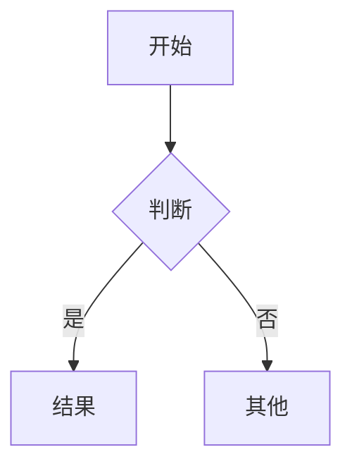

# Jotdown 示例

这是一段**粗体**、*斜体*、~~删除线~~、`行内代码` 和 [链接](https://example.com)。my_var 不会被转义，[[双向链接]] 和 #标签 原样保留。

[TOC]

## 列表

* 星号列表
* 第二项
    * 嵌套

1. 有序
2. 第二

- [ ] 待办
- [x] 已完成

## 表格

| 左对齐 | 居中 | 右对齐 |
|:-------|:----:|-------:|
| a      |  b   |      c |
| 中文   | 测试 |    123 |

## 代码

```js
function hello(name) {
  // greet
  return `Hello, ${name}!`
}
```

## 公式

行内公式 $E = mc^2$，以及块公式：

$$
\int_0^\infty e^{-x^2} dx = \frac{\sqrt{\pi}}{2}
$$

## 提示块

> [!NOTE] 小提示
> 这是一个 **提示块**。

> [!WARNING]
> 小心。

> 普通引用

## 图表



脚注引用[^1]。

[^1]: 这是脚注内容。

<svg width="80" height="40"><rect width="80" height="40" rx="6" fill="#4a90e2"/></svg>

---

Setext 标题
===========
